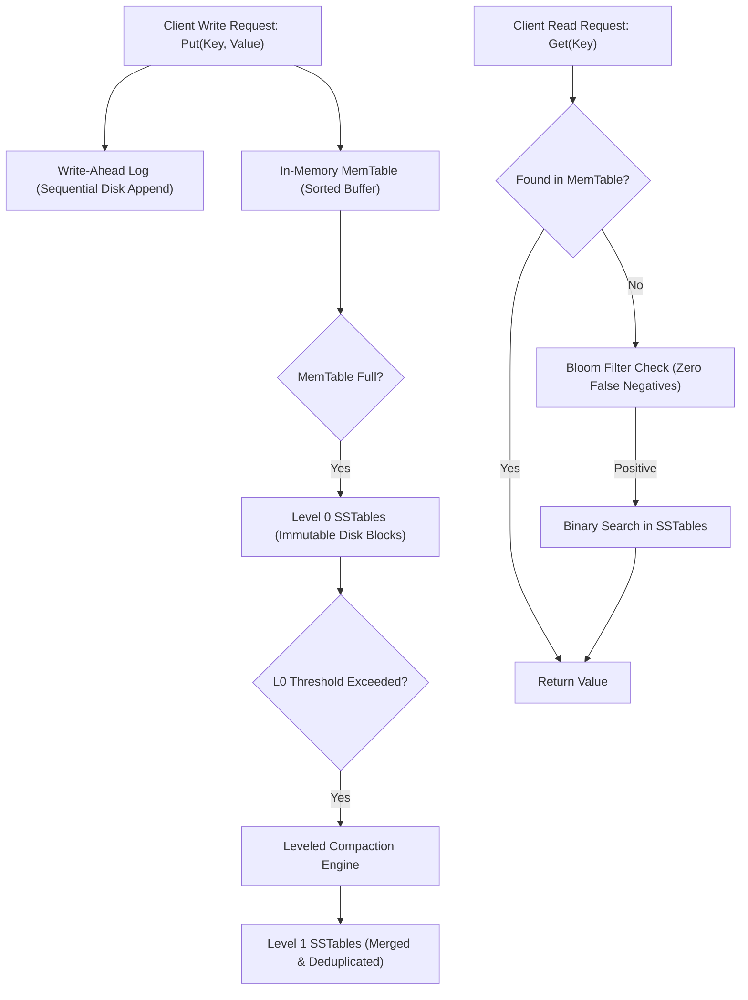

# PulseKV // LSM-Tree Storage Engine Architecture

> **Architect & Lead Engineer:** أ. طارق ابوعشي  
> **Repository:** `Tareq0001/PulseKV-Storage-Engine`  
> **Live Interactive Storage Workbench:** [https://tareq0001.github.io/PulseKV-Storage-Engine/](https://tareq0001.github.io/PulseKV-Storage-Engine/)

---

## 🏛️ Executive Architecture Summary

**PulseKV** is an in-depth implementation of modern storage engine fundamentals modeled after industry-standard engines such as **RocksDB**, **LevelDB**, and **Apache Cassandra**. It implements the **Log-Structured Merge (LSM) Tree** storage paradigm, trading occasional compaction overhead for blazing-fast sequential write throughput ($O(1)$ disk appends) and efficient disk space utilization.



---

## 🚀 Key Architectural Guarantees

1. **Sequential Durability via WAL:** Every mutation is appended sequentially to disk before memory confirmation, guaranteeing zero data loss across process failures.
2. **In-Memory Sortation (MemTable):** Eliminates random disk writes by buffering mutations in memory in lexicographical order.
3. **Probabilistic Bloom Filter Filtering:** Ensures disk reads are bypassed for missing keys with **zero false negatives**:
   $$P(\text{false positive}) \approx \left(1 - e^{-kn/m}\right)^k$$
4. **Sparse Indexing & Binary Search:** SSTables index only every $N$-th key, reducing index RAM consumption by up to 90%.
5. **Leveled Compaction:** Incrementally coalesces multiple overlapping SSTables into non-overlapping higher levels, purging expired records and deletion tombstones.

---

## 📁 Repository Structure

```text
PulseKV-Storage-Engine/
├── .github/workflows/
│   └── ci.yml               # Automated CI test suite
├── src/
│   ├── storage/
│   │   ├── wal.js           # Append-Only Write-Ahead Log
│   │   ├── bloom-filter.js  # 128-bit Probabilistic Hash Filter
│   │   ├── memtable.js      # Lexicographically Sorted Buffer
│   │   ├── sstable.js       # Immutable Disk File & Sparse Index
│   │   └── compaction.js    # Multi-Way Merge & Compactor
│   └── engine.js            # Unified Storage Engine Coordinator
├── tests/
│   └── pulsekv.test.js      # Comprehensive Test Suite
├── index.html               # Live Interactive Storage Visualizer
├── Dockerfile               # Production Container
└── package.json
```

---

## 🧪 Running Tests & Local Execution

```bash
# Run unit tests
npm test

# Run via Docker
docker build -t pulsekv-engine .
docker run --rm pulsekv-engine
```

---

## 🏛️ Author & Attribution

**أ. طارق ابوعشي**  
*استشاري ومعماري هندسة البرمجيات والأنظمة الموزعة*  
*Abha, Saudi Arabia*
